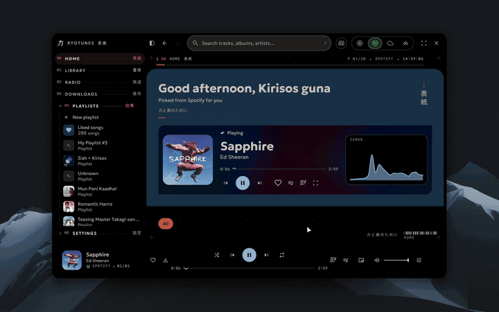
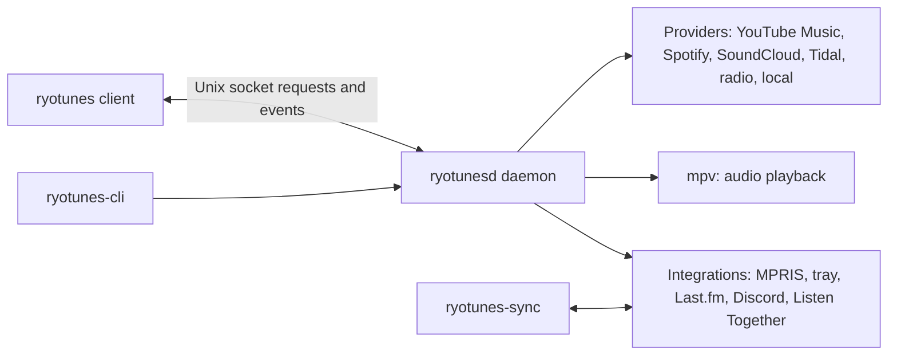

# Ryotunes for Windows

An unofficial Windows port of **Ryotunes 2**, the Go rewrite of Ryoku's music
player (YouTube Music, Spotify, SoundCloud, Tidal, internet radio and local
files). It is built from the `hyperion` branch of
[ryoku-dev/ryotunes](https://github.com/ryoku-dev/ryotunes) with the smallest
changes that make it build and run on Windows 10/11, in the same Go code.



<!-- Full demo video on YouTube: add the link here once it is published. -->

## Download

Download `Ryotunes-Setup-<version>-x64.exe` from
[Releases](https://github.com/Kirisos-Guna/ryotunes-windows/releases) and run
it. It installs for your user account only (no administrator prompt), adds a
Start-menu shortcut and an uninstaller, and includes `libmpv-2.dll` and
`yt-dlp.exe`. To use downloads and local-file scanning, also install FFmpeg:

```powershell
winget install Gyan.FFmpeg
```

## Spotify

Spotify songs play in Spotify's own Web Player, which Ryotunes runs in a hidden
browser window with its own profile in `%LOCALAPPDATA%\Ryotunes\spotify-player`,
using the bridge from
[Myspoti](https://kirisos-git.centralindia.cloudapp.azure.com/Kirisos/myspoti).
Sign in once in the window that opens the first time you play a Spotify song.
Ryotunes never uses your everyday browser, its tabs or its sign-ins.

- The player uses Brave when it is installed, else Microsoft Edge or Chrome.
  Brave's built-in ad blocking may stop some of Spotify's ads on a Free
  account.
- Home is your own Spotify Home. Album, artist and search pages, saved albums
  and followed artists are read through the Web Player too, so they work while
  Spotify rate-limits its public Web API.
- Lyrics come from Spotify when it gives them, else from Ryotunes' other lyrics
  sources (LRCLIB and others), synced where available.
- Lyrics extensions written for Myspoti work too: see
  [docs/WINDOWS-PORT.md](docs/WINDOWS-PORT.md#myspoti-extensions).

## YouTube Music and SoundCloud

Choose **Sign in** and a browser window opens on Google's (or SoundCloud's)
sign-in page. It belongs to Ryotunes' own browser profile, the one the Spotify
player uses, not your everyday browser. Sign in there; Ryotunes takes the
session from that window and closes it.

YouTube songs play as audio streams through mpv, with no video and no ads.

## Appearance

**Settings › Appearance** chooses the design (Lithic, Material, Adwaita or
Fluent), light or dark, contrast and reduced motion. On a Ryoku Linux desktop
these follow Ryoku Settings instead.

## Visualizer

Bars, Curve, Scope and Stereo draw what your speakers play (a WASAPI loopback
capture of the default output device), Spotify and YouTube alike. Choose the
style in **Settings › Appearance**, or click the visualizer on Home.

## Troubleshooting

| Problem | What to do |
|---|---|
| Spotify skips to other songs or stays silent | Spotify may have refused the player's browser profile. Close Ryotunes, rename `%LOCALAPPDATA%\Ryotunes\spotify-player`, open Ryotunes and sign in to Spotify again. |
| Ryotunes did not start after a crash | A damaged database is now moved aside (`ryotunes.sqlite.damaged-<time>`, next to it) and a fresh one is started. Spotify stays signed in; sign in to YouTube and SoundCloud again. |
| A sign-in window is hidden | Choose **Sign in** again: Ryotunes brings the open window forward. |

## Build from source

```powershell
winget install GoLang.Go
winget install JRSoftware.InnoSetup
powershell -ExecutionPolicy Bypass -File release\windows\build-windows.ps1
```

No C compiler is needed: everything builds with `CGO_ENABLED=0`. See
[docs/WINDOWS-PORT.md](docs/WINDOWS-PORT.md) for what changed from upstream
and what is not available on Windows (MPRIS/tray,
Ryoku theming).

## Updates

A daily GitHub Action watches upstream's `hyperion` branch. When upstream
changes, it builds and publishes a new Windows release on its own. Ryotunes
checks for new releases at startup and installs them from
**Settings › About › Install**, so there is nothing to check by hand.
Details: [docs/WINDOWS-PORT.md](docs/WINDOWS-PORT.md#staying-up-to-date-with-upstream).

Licensed GPL-3.0-or-later, like upstream. Not affiliated with the Ryoku
project; please report Windows-specific problems here, not upstream.

---

*The upstream README follows.*

# Ryotunes

Ryotunes is Ryoku's music player for YouTube Music, Spotify, SoundCloud, Tidal, internet radio and local files. Playback is audio only. The interface is drawn in [Lithic](https://github.com/ryoku-dev/ryoku/tree/main/docs/lithic) in the Ryoku Settings language and follows the Style page of Ryoku Settings, so its design, colours, light or dark, contrast and motion change with the rest of the desktop.

Ryotunes 2.0 is a rewrite in Go of the 1.x Rust and Quickshell app; settings, library data and sign-ins carry over.

## The experience

| Surface | What it provides |
|---|---|
| Home | Continue listening, recent music, shortcuts, provider shelves and your last two weeks of listening |
| Search | Songs, albums, artists and playlists across the selected provider |
| Library | Liked music, account playlists, device playlists and local music |
| Radio | Searchable internet radio stations with live audio playback |
| Now playing | Artwork, track details, playback controls and access to the queue and lyrics |
| Lyrics | Synced and plain lyrics, click-to-seek and optional romanization |
| Queue | Manual ordering, continuation, shuffle, repeat and stop after current |
| Downloads | Audio downloads with bounded workers, progress and persistent history |
| Mini player | A compact second window backed by the same playback state |
| Integrations | MPRIS, media keys, tray, Last.fm, Discord and Listen Together |

Ryotunes does not play music videos.

## Lifecycle

| Action | Result |
|---|---|
| Close the window | The client closes while playback and active downloads continue in `ryotunesd` |
| Leave the daemon idle | With no client, playback, download or Listen Together room, the daemon exits after five minutes |
| Open Ryotunes again | The client reconnects to daemon-owned playback and queue state |
| Choose Quit | Playback stops, MPRIS unregisters, integrations close and the daemon exits |

## Install

Ryotunes 2.0 is a prerelease, [v2.0.0](https://github.com/Ryoku-dev/ryotunes/releases/tag/v2.0.0). GitHub's latest release is still the 1.x line.

### Ryoku

Ryoku Hyperion installs Ryotunes 2 for you. Install or update it from Ryostore › Ryoku apps, or run:

```sh
ryoku update
```

### Arch Linux and CachyOS

Download the pacman package and matching checksum from the [v2.0.0 prerelease](https://github.com/Ryoku-dev/ryotunes/releases/tag/v2.0.0), then verify and install them:

```sh
sha256sum -c ryotunes-2.0.0-1-x86_64.pkg.tar.zst.sha256
sudo pacman -U ./ryotunes-2.0.0-1-x86_64.pkg.tar.zst
```

The package has pacman epoch `1`, although the release filename does not include it. See [the Arch install guide](docs/INSTALL-ARCH.md) for source builds and service details.

### Void Linux

From a clone or release source archive, run:

```sh
./release/void/install.sh
```

The installer verifies the release package, repacks it as an xbps package and installs it with the dependencies in `release/void/depends`. See [the Void install guide](docs/INSTALL-VOID.md).

## Architecture



The daemon owns playback, providers, storage and integrations. The client owns windows and presentation. See [the architecture guide](docs/ARCHITECTURE.md) and [persistence reference](docs/PERSISTENCE.md).

## Repository map

```text
cmd/
  ryotunes/          Gio desktop client
  ryotunesd/         playback daemon
  ryotunes-cli/      one request or event stream per invocation
  ryotunes-sync/     optional Listen Together relay
internal/
  client/            Lithic kit, connection, state, artwork and UI
  daemon/            protocol handlers and lifecycle wiring
  provider/          YouTube, Spotify, SoundCloud, Tidal, radio and local sources
  player/            mpv playback
  queue/             queue order, continuation and restore
  store/             SQLite and private files
  downloads/         download queue and workers
  lyrics/            lyric sources, parsing and romanization
  integrations/      MPRIS, tray, Last.fm, Discord and Listen Together
  protocol/          shared socket methods, events and wire types
release/             packages, user units, diagnostics and release gates
docs/                architecture, persistence, design, install and support
```

## Development

Build and test the Go tree:

```sh
go build ./...
go test ./...
```

Run a daemon without touching the installed socket or library:

```sh
root=$(mktemp -d)
mkdir -p "$root/run" "$root/data" "$root/cache" "$root/config" "$root/state"
XDG_RUNTIME_DIR="$root/run" \
XDG_DATA_HOME="$root/data" \
XDG_CACHE_HOME="$root/cache" \
XDG_CONFIG_HOME="$root/config" \
XDG_STATE_HOME="$root/state" \
go run ./cmd/ryotunesd
```

Render a demo frame without a display:

```sh
ryotunes --demo --png out.png
```

Contributors should read [CONTRIBUTING.md](CONTRIBUTING.md) and run `./release/check.sh` before sending a change.

## License and credits

Copyright (C) 2026 Ryoku-dev and contributors.

Ryotunes' own source code is distributed under [GPL-3.0-or-later](LICENSE). The client and daemon binaries include GPL-3.0-only components and are distributed under GPLv3 only. The project copyright, trademark term, Lithic credit and retained upstream work are recorded in [NOTICE](NOTICE). Licenses for linked Go modules, fonts and icons are in [THIRD_PARTY_NOTICES](THIRD_PARTY_NOTICES), and the full project history is in [UPSTREAM.md](UPSTREAM.md).
